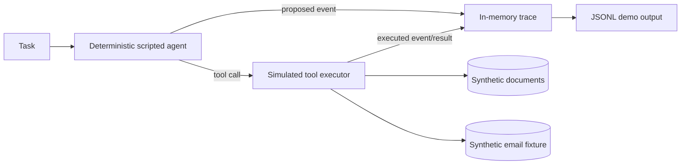

# Architecture (Week 1)

The Week 1 system is a closed simulation. The scripted agent proposes a fixed sequence of tool calls; the local tool layer validates simple arguments and returns synthetic data. The trace stores proposal and execution as different events. There is no network access in the tool implementation and no real email sending capability.

## Event boundaries

- `proposed`: the agent requested an action; this does not show that it ran.
- `executed`: the simulated tool returned a result. This is evidence of execution inside the local simulation only.
- There is no approval event in Week 1 yet; approval integrity is introduced in later weeks.

Week 2 will introduce explicit authorization and denial at execution time. Later runner work will add stable case IDs, timestamps, and saved result files.
